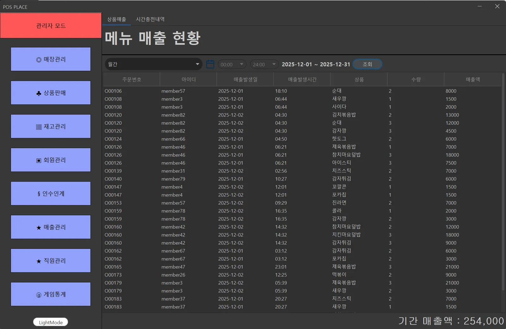
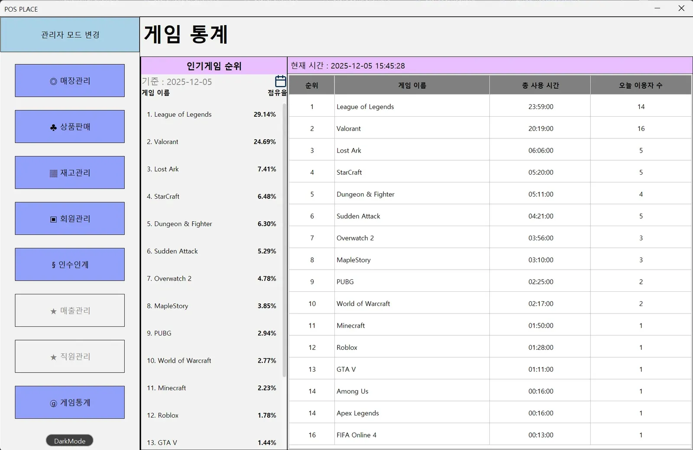
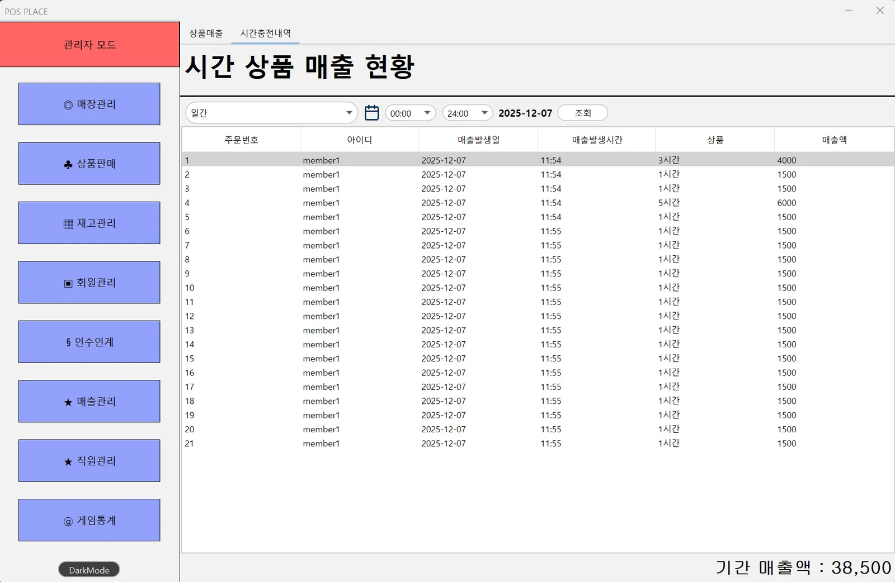

# POS PLACE

PC방 카운터에서 쓰는 데스크톱 POS 프로그램입니다. 좌석, 음식 주문, 재고, 회원, 직원, 매출을 한 프로그램에서 봅니다.

Java Swing과 MySQL로 만들었고, 2025년 2학기 객체지향언어실습 기말 과제로 4명이 함께 했습니다.



<table>
  <tr>
    <td></td>
    <td></td>
  </tr>
  <tr>
    <td align="center"><sub>게임 통계</sub></td>
    <td align="center"><sub>시간 충전 매출, 라이트 모드</sub></td>
  </tr>
</table>

## 메뉴

| 메뉴 | 하는 일 |
| --- | --- |
| 매장 관리 | 좌석을 격자로 보여 주고 사용 시작, 종료, 시간 충전을 한다. 고장 난 좌석은 막아 둔다 |
| 상품 판매 | 카테고리나 검색으로 메뉴를 담아 주문을 받는다. 조리 중과 완료 탭으로 나눠 본다 |
| 재고 관리 | 재료별 재고를 보고 입고와 출고를 기록한다. 최소 재고 아래로 떨어진 재료는 따로 모아 보여 준다 |
| 회원 관리 | 회원을 가입시키고 정보를 고치거나 지운다 |
| 인수인계 | 교대할 때 그 근무 시간의 매출을 모아 보여 주고, 금고에 있어야 할 돈과 실제 현금의 차이를 계산한다 |
| 매출 관리 | 음식 매출과 시간 충전 매출을 나눠 일, 주, 월, 시간대별로 본다 |
| 직원 관리 | 직원 정보를 보고 입사와 퇴사를 처리한다 |
| 게임 통계 | 날짜별 인기 게임 순위와 게임별 이용 시간을 본다 |

매출 관리와 직원 관리는 관리자 모드로 들어가야 열립니다. 일반 직원은 매출과 다른 직원 정보를 볼 수 없습니다.

화면 전체를 다크 모드와 라이트 모드로 바꿀 수 있습니다. 처음엔 화면마다 `setBackground`로 색을 직접 칠했는데, 이걸 모두 걷어내고 FlatLaf IntelliJ 테마가 색을 정하게 바꾼 뒤에 전환 버튼을 달았습니다.

## 재고가 알아서 줄어드는 구조

라면 하나를 팔면 그 라면에 들어가는 재료가 각각 줄어야 합니다. 메뉴마다 어떤 재료가 몇 개 들어가는지 `menu_ingredient` 테이블에 적어 두고, 주문이 들어오면 거기에 맞춰 재료를 빼고 매출을 올립니다.

재료는 보통 박스로 들어옵니다. 입고할 때 박스 수를 넣으면 MySQL 트리거가 `stock_info.unit_quantity`를 곱해 낱개 수로 바꾼 뒤 재고에 더합니다.

주문을 취소하거나 환불하면 같은 트랜잭션 안에서 매출도 같이 빠집니다.

## DB 연결이 자꾸 끊기던 문제

처음엔 `DBConnection`을 싱글톤으로 만들어 연결 하나를 모든 화면이 같이 썼습니다. 그런데 한 번 닫힌 연결은 null이 아니어서 다시 만들어지지 않았고, 그 뒤로는 DB를 쓰는 화면마다 오류가 났습니다. 프로그램이 끝날 때 누가 닫아야 하는지도 애매했습니다.

이 정도 규모에서는 매번 새로 여는 비용을 감수해도 된다고 보고, DB를 쓸 때마다 연결을 열고 끝나면 닫게 바꿨습니다. 다른 코드는 그대로 `getConnection()`을 부르면 됩니다.

## 실행

MySQL 8.0과 JDK 17이 필요합니다.

```bash
# 1. DB와 테이블, 트리거 만들기. 기존 POS_PLACE DB는 지워진다
mysql -u root -p < POS_PLACE_INIT.sql

# 2. 회원 100명, 직원, 메뉴, 재고 같은 예시 데이터 넣기
mysql -u root -p < dumy_data_init.sql

# 3. 실행
./gradlew run
```

실행 전에 `app/src/main/resources/db.properties.example`을 같은 폴더에 `db.properties`로 복사하고 DB 주소, 계정, 비밀번호를 적습니다. 이 파일은 git에 올라가지 않습니다. 환경 변수 `POS_DB_URL`, `POS_DB_USER`, `POS_DB_PASSWORD`로 줘도 됩니다.

예시 데이터를 넣었다면 직원 이름 `admin`, 비밀번호 `1234`로 로그인합니다. 비밀번호를 5번 틀리면 프로그램이 꺼집니다.

## 코드

```
app/src/main/java/
├── client/     Swing 화면. 메뉴마다 폴더 하나
├── service/    화면과 DAO 사이의 계산
├── dao/        테이블마다 SQL을 실행하는 클래스
├── dto/
├── db/         DBConnection
└── util/       로그인 확인, 비밀번호 처리
```

## 만든 사람

4명이 메뉴를 나눠 맡았습니다.

[@lilohdong](https://github.com/lilohdong)은 프로그램의 뼈대를 잡았습니다. 프로젝트를 Gradle로 옮겨 팀원 PC 어디서나 FlatLaf 같은 외부 라이브러리가 받아지게 했고, 로그인 화면, 메인 화면, 사이드바, 매출 관리, 게임 통계를 만들었습니다. 위의 DB 연결 문제도 고쳤습니다.

좌석, 상품 판매와 재고, 회원, 인수인계 화면은 다른 팀원들이 만들었습니다.
